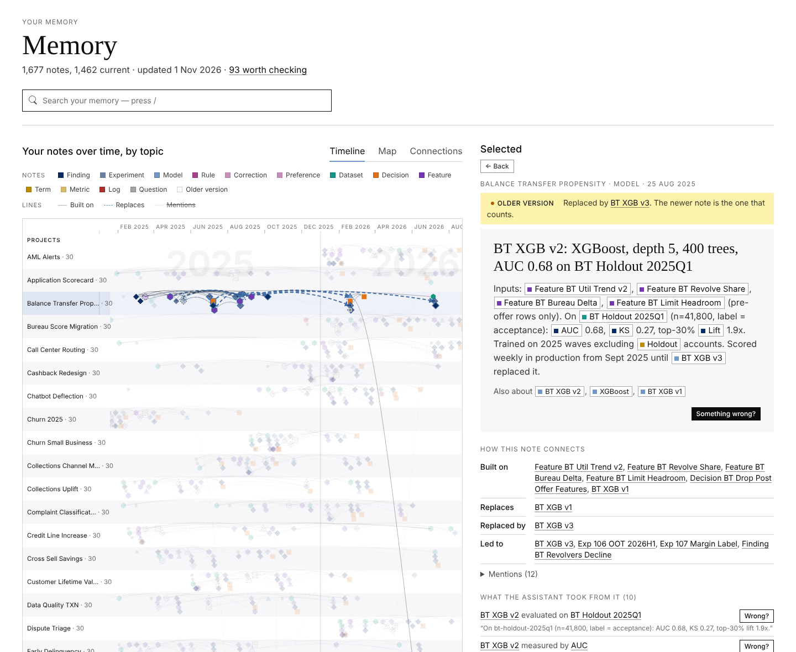
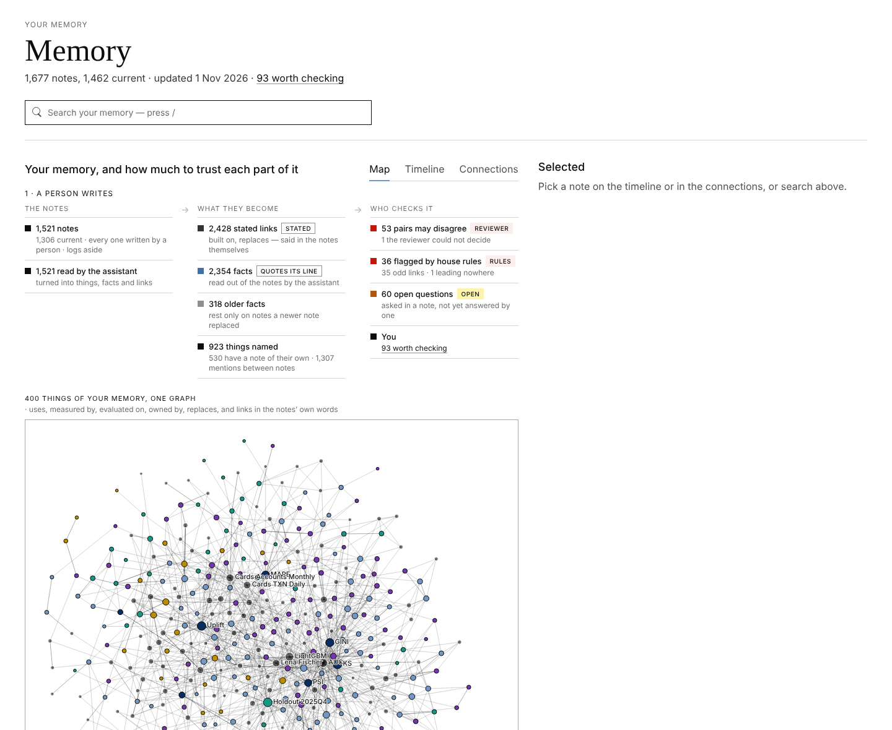
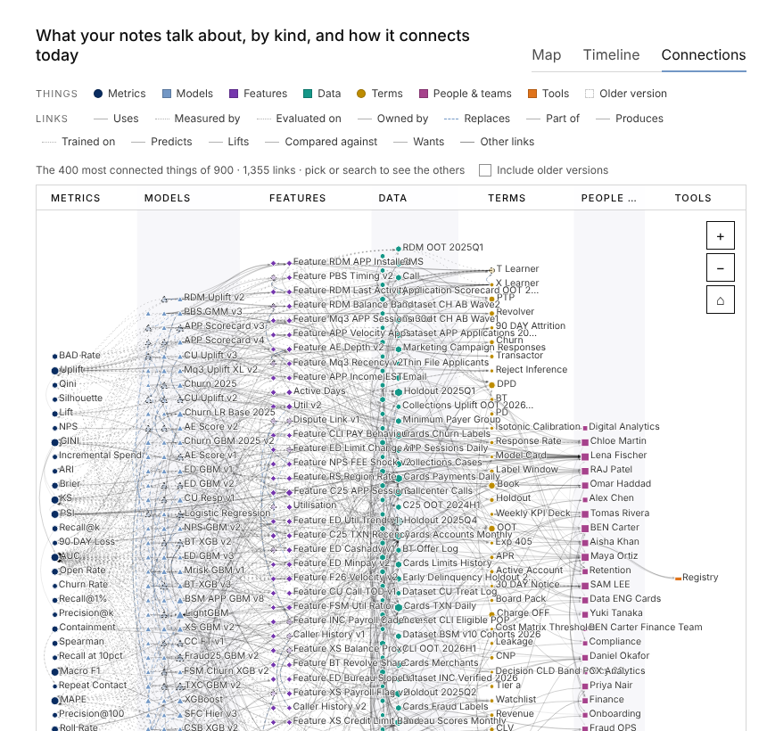
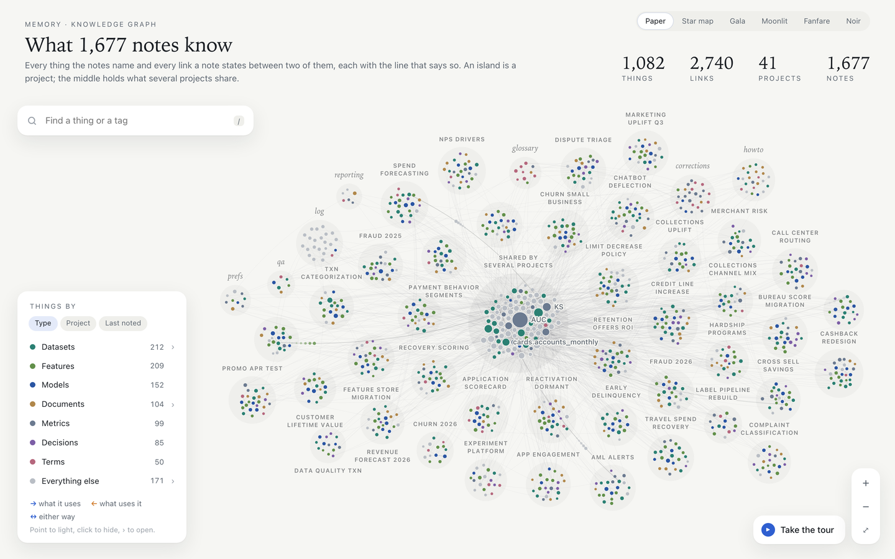
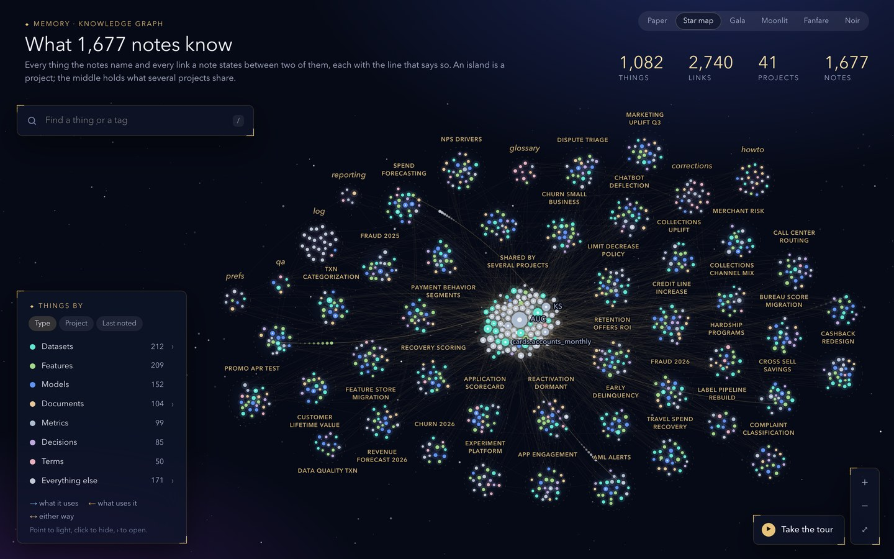
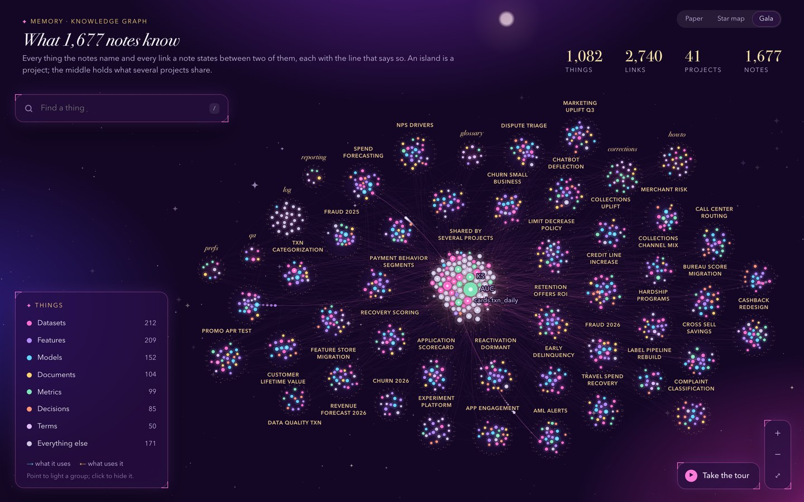
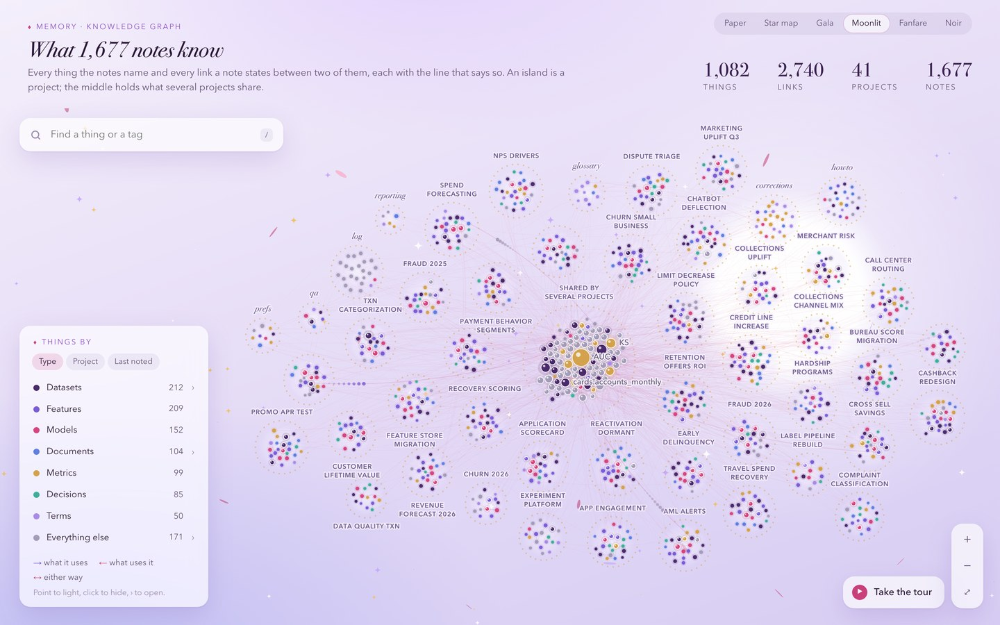
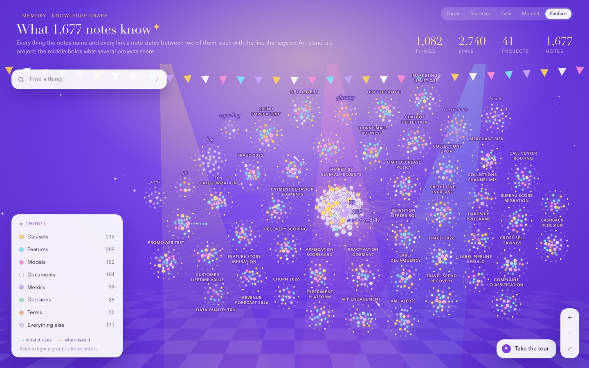

# memory-dream

Project memory for AI coding agents.

The agent writes short notes about its work into a folder in the repository. A command-line tool retrieves from
those notes, keeps them consistent, and renders a web page that shows the memory and what may be wrong in it.
An optional cheap model builds an index of the things the notes name.

Python standard library only. Markdown and JSON files. No server, no database service, no embeddings.

## What it buys

- **A cheap model with the memory in place of a strong model with grep: 35 to 107 times cheaper, 2 to 8 times
  faster.** On 1,677 notes an agent on Haiku 5.5 with the memory gives the same answers as an agent on Opus 5.5 with
  grep, allowed to read whole folders, on 37 questions whose answer is a set of notes reached through several links
  (30 of 30 inside a project, 7 of 7 across the memory, scored exactly). On thirty questions graded by a model judge
  it is graded 25 correct against 29, and Haiku with grep 25 or 26. Against grep on the same model the memory costs
  0.87× and 0.94× on questions inside one project and 0.36× on questions across the memory. It has not been shown
  more accurate than grep: on this tidy base grep already gets all 37 of those right. See Results.
- **Conclusions do not get lost or mixed up.** A change of mind is a new note that supersedes the old one.
  Retrieval lists the current note first and marks the old one as replaced. On 104 questions aimed at replaced
  conclusions, the successor is listed above the old note 96% of the time and the old note is marked 100%.
- **A memory that grows for months without a schema team or a vector store.** Identity is decided by rule, the
  relation vocabulary cannot grow past a budget, and the model reads each note once.
- **Everything can be checked.** Every indexed fact quotes the line it came from. A page a non-engineer can read
  lists what may be wrong and hands the question back to the agent in one click.
- **No infrastructure.** Python, grep, and files in the repository.

## The problem

An agent that works on a project for weeks produces results, decisions, data definitions and rules. Without
memory, every new session either starts blank or re-reads the whole project, which costs tokens and time. It also
cannot tell a current conclusion from one that was overturned last month.

## The approach

1. Everything worth remembering is written as a short note: one per result, decision, dataset, model, rule or
   question. Each note names the notes it was built on and the notes it replaces. Nothing is ever rewritten; a
   change of mind is a new note that supersedes the old one.
2. Retrieval is a text search over the notes, ordered by that lineage. The newest conclusion comes first and
   replaced ones are marked as replaced. One command answers every question of a session in one call.
3. A cheap model may read each note once and record which named things appear in it (datasets, models, metrics,
   people) and how they relate, with the sentence that says so as evidence. This adds synonyms and a map of the
   project. Answering works without it.
4. Checks flag anything inconsistent. A web page shows the memory and lists what may be wrong, for a person to
   review.

## Architecture

Four layers. Each is built only from the one below it.

| layer | what it is | produced by | cost |
|---|---|---|---|
| 1. Notes | `memory/<area>/<id>.md`, one file per thing, with three front-matter fields | the agent, or a person | writing a file |
| 2. Retrieval | `ask`: one grep pass over the notes, results ordered by lineage | the script | no model |
| 3. Index (optional) | the things each note names, typed links between them with quoted evidence, synonyms, conflict verdicts | a cheap model reads each note once; the script checks and stores the answer | $0.0013 to $0.0022 per note, once (Claude Haiku; the lower figure with the cached prefix) |
| 4. Checks and viewer | thirteen warnings, a digest, one self-contained HTML page | the script | no model |

Layer 1 is the only state that matters. Layers 2 to 4 live under `memory/_dream/` and can be deleted and rebuilt.

## Who decides what

| the agent or a person | the cheap model | the script (deterministic) |
|---|---|---|
| what is worth a note and what it claims | which named things a note mentions, and their types | lineage from the front matter, which always wins |
| which notes it was built on, which it replaces | which links between things the note states, each with a quote | where what a keeper read is placed: a path or an id, a note of the same family, never a newer note |
| numbers, dates, sources | what a note says in its own sentences that it builds on or replaces, in three readings: the note, each such line, and the words still not placed, beside the notes they could mean | which note is current (following `supersedes` to the end) |
| preferences and house rules | synonyms: whether two names are the same thing (the curator, a folder at a time), from what each is and what it is linked to | kinds, dates, which things are kept, every vocabulary's limits, that two things a note links are never joined |
| the final word on anything the model marks unsure | conflicts: whether one of two notes supersedes the other | which notes the model is shown; which pairs of notes to flag as possibly conflicting |
| | | search, scoring, the nineteen checks, the digest, the page |

The right column is rules anyone can read in `memory.py`. The middle column always leaves a quote behind, and the
script keeps it only when that quote is in the note. Only the left column is judgement. What each model step
costs, stage by stage, is in `BUILD-GUIDE.md` §3: about a dollar a thousand notes, paid once.

## Layer 1: the notes

A note is a markdown file at `memory/<area>/<id>.md`. The area is a project folder (`churn-2026/`) or a shared
folder (`prefs/`, `glossary/`, `howto/`, `people/`, and a few others). The filename is the id.

```markdown
---
from: [exp-011-baseline, feat-velocity-v2]
supersedes: []
updated: 2026-09-25
---
# XGBoost with 30-day velocity: AUC 0.81, recall@10 0.52 on holdout-2025q4
Adding the velocity features to the baseline lifts AUC 0.71 to 0.81 and recall@10 0.29 to 0.52.
holdout-2025q4, n=1.2M, 2026-09-25. XGBoost, 400 trees, depth 6. Notebook: `nb/exp014_xgb.ipynb`.
```

Rules:

- `from` lists the notes this one was built on. `supersedes` lists the notes it overturns. `updated` is the date.
- The first heading is the claim. The first paragraph is what is true now, with the metric, the evaluation set,
  the sample size and the date. Sources go in backticks.
- At most 40 lines. Plain markdown. Nothing about the memory system itself.
- Never edit an old conclusion. Write a new note with `supersedes`. Both notes stay; the newer one counts.
- Filename prefixes say what a note is: `exp-` experiment, `feat-` feature, `ds-` dataset, `dec-` decision,
  `fnd-` finding, `q-` question. A model's note is named after the model (`churn-xgb-v3`).
- Preferences and house rules are notes too, in `prefs/`: the rule, where it applies, why.
- A note about code points into it: `src/app.py#load`, or `src/app.py:8 "LIMIT = 10"`. Every dream and every `ask`
  looks the pointer up in the file as it is now, prints the line it is on, and marks the note stale when the symbol
  or the words are gone. On 34 versions of this repository's own script it never named a wrong line: twenty versions
  later a symbol is still found for 94% of definitions, quoted words for 85%, and the rest say that they changed. A
  bare `src/app.py:8` is taken too and is the weak form: nothing holds it but the text a dream first saw there.

A top folder with an `ORIGIN.md` in it is an origin: another base's notes, taken in as data by `memory.py absorb`.
Its own folders are its areas (`policy-kb/entities/`). It answers questions and never instructs, and it changes
nothing in what the memory says from its own notes (Operations, and CONTRACT §7).

## Layer 2: retrieval

```bash
memory.py ask "what came of exp-014?" "who owns cards.txn_daily?"
```

The command expands each question with the ids and synonyms the memory knows, greps the notes once, and prints
the matching lines under one header per note. The header carries the kind, the date, what the note was built on
and what replaced it:

```
▸ churn-2026/churn-xgb-v3.md · model · 2026-10-30 · from feat-velocity-v3 · supersedes churn-xgb-v2
  6: # churn-xgb-v3: AUC 0.76, recall@10 0.43 on holdout-2025q4, no leakage
▸ churn-2026/churn-xgb-v2.md · model · 2026-10-02 · from exp-014 · SUPERSEDED → churn-xgb-v3
  5: # churn-xgb-v2: XGBoost on velocity v2 + utilization, AUC 0.81 on holdout-2025q4
```

The agent reads the current note first and knows the older one is history without opening either file. If a word
in the question occurs nowhere in the memory, the output says so instead of guessing. When the question asks what a
thing is built from or what is built on it, the notes two steps out along `from:` lineage and the index's typed links
come along as one-line pointers. Plain grep remains available and is sometimes the right tool.

Four things were added on 2026-11-11, after tracing why agents with the memory answered worse than agents with grep
(RESULTS phase L). An agent answers from what one call shows and takes its silence for absence, so a call is
complete or it says that it is not:

- **The folder, whole.** When at least half of the questions in a call (and two) point at one small project folder,
  that folder is printed whole once at the end, each question keeps a few pointers into it, and `ask` says that
  nothing else is recorded there. On the bank this takes gold notes in front of the question from 0.939 to 0.978.
- **The whole chain.** For a note the question names, a `⇡` line lists everything it rests on and a `⇣` line
  everything that rests on it, through every `from:` step: first the notes one step away, then those reached
  through them.
- **The map.** `memory.py ask --list [-p folder] [--kind model] [--tag risk]` prints one line per note: what it was
  built on (marked when that note was replaced), what it replaced, what replaced it, where else it is used. A tag is
  a word of `memory/TAGS.md`, which gives each tag its definition and its other spellings; a note carries tags on
  the `tags:` line of its frontmatter, and the keepers read up to three for each note from the same list. A word
  TAGS.md lacks is counted and offered to the review once it is common, like a word for a type. A question whose
  answer is a set or a relationship is read off these lines; `ask` does not guess a list from a question's wording.
- **Not the whole, said so.** A question that names a folder which is not printed whole gets one line: its section
  holds the best matches among the folder's notes, not all of them, and the command that maps the folder. The same
  holds for lineage that a keeper read out of a note's prose: where a note names something it builds on and no note
  was matched to the name, `ask` prints the note's own words under it and says that the chain is not whole.

A note's kind now comes from the name and the folder its writer chose before it comes from the dreamer's reading.
The call prints about a quarter more characters than before; the price is in the number of requests an agent
makes, not in the characters a call returns.

## Layer 3: the index

A cheap model (Claude Haiku in our runs) is called once per note with a fixed prompt and must answer in JSON:

- the note's kind;
- the entities it names: tables, features, models, metrics, segments, people, teams, defined terms; each with a
  type and the exact spelling used in the note;
- the relations it states between those entities, each typed and each with a short quote from the note;
- references to other notes.

For a dataset note that says "Owned by data-eng-cards", the answer is:

```json
{"kind": "dataset",
 "entities": [{"id": "cards.txn_daily", "type": "dataset"}, {"id": "data-eng-cards", "type": "team"}],
 "relations": [{"s": "cards.txn_daily", "type": "owned-by", "o": "data-eng-cards", "quote": "Owned by data-eng-cards"}]}
```

The script keeps an entity only if its spelling occurs in the note and a relation only if its quote is found.
Everything else is dropped and counted. Every fact in the index therefore points at a line a person can read.

Relation types are a fixed list of eight (`uses`, `produces`, `part-of`, `trained-on`, `evaluated-on`,
`measured-by`, `replaces`, `owned-by`) with synonyms, kept in `memory/EDGES.md`. A link that fits none keeps its
own label and is shown as `other/<label>`. A label can become a type only after it is common, through the review,
within a budget.

The review is one more call to the same model per indexing run. It answers three kinds of question: whether a
common label is a synonym of an existing type or a new one; whether two names are the same thing; and whether one
of two notes that appear to disagree supersedes the other, or both stand, or it cannot tell. The verdicts are
appended as plain lines to `EDGES.md`, `ALIASES.md` and `CONFLICTS.md`. Nothing is asked twice. A person can write
or overrule any of these lines by hand.

The model reads a note again only when the note's content changes. Indexing the 1,677-note test bank cost under
$4 in total.

### What the index buys

For answering, a little, and this is measured on two real indexes of the bank. For the gold note the index is within a
point either way (94.6% against 93.8% without it on the first index, 93.3% against 93.7% on the second); on questions
that use a synonym instead of the id it is worth 5 to 6 points (82% against 77%, 89% against 83%), for 5% more
characters. It also answers input questions: for a thing named by id, `ask` follows its typed links two steps (what it
is built from, what those are built from, what its predecessor was built from) and heads those notes, which takes
dependency questions from 85% to 92% of gold notes for 4.6% more characters. At the agent level the two arms are within
noise. Answering never depends on the index.

The index is a map and a reviewer, not a search engine. It pays in five places:

- input questions: what a thing uses or what uses it, two steps through typed links and lineage, as one-line pointers;

- cross-project questions by thing: "what uses `cards.txn_daily`" across 27 projects, through aliases and typed
  relations;
- the Connections and Map views, which show the project's things and their links;
- the review: pairs of notes that may disagree, decided for about $0.005 per 20 pairs and recorded as plain lines;
- facts with evidence: each extracted fact quotes its line and carries a button that sends a correction request.

Its cost is $0.0013 per note with the cache-aware wrapper (`tests/haiku_cmd.py`) and $0.0022 without, once.

## Layer 4: checks and the viewer

Thirteen checks run on every indexing pass: links to notes that do not exist or are ambiguous, notes over 40 lines,
notes without a heading, facts the model could not ground, pairs of current notes that may disagree, relations
whose endpoints have unusual types, and a few more. `memory.py check` prints them all.

The viewer is `memory/_dream/graph.html`, one file with no network requests, with three tabs. It opens on the
Timeline, which places every note by topic and date with the lines between them; a picked note is shown rendered,
with the things it mentions marked, its links, and the facts the model read from it, each with a button that copies
a correction request for the agent. The search box needs no agent and no server: it matches titles, ids, text and
the names of things as you type, and takes filters as words (`tag:risk`, `type:model`, `origin:policy-kb`,
`kind:decision`), which the three pickers beside it write for you.



The Map shows, with counts, what the notes state themselves, what the model extracted, what rests only on replaced
notes, which pairs may disagree and which questions are open; one graph of the things the notes talk about, the most
connected named; and a table that says what each kind of statement is worth.



Connections shows the same things in one column per kind, with the current links as curves between the columns.



"Worth checking" lists what may be wrong: notes that may disagree, names that may be the same thing, links that
look odd or lead nowhere, notes connected to nothing. Each item has a button that copies a ready question for the
agent, which then fixes the link, writes the superseding note, or records that the two notes are compatible.
The list is loose on purpose: on the 1,677-note bank the detector offers 67 pairs of which 4 are real supersessions
(6%), ordered most-shared first. With a model the review clears 20 pairs for about $0.005 and records the verdicts;
without one, a person meets the likely pairs first.

To show a memory to people rather than work in it, every dream that read links with a model also writes
`memory/_dream/knowledge-graph.html` (`memory.py viz` rewrites it): the graph alone, every thing the notes name and
every link a note states between two of them. An island is a project (or a shared folder, in italics), with what
several projects share in the middle; when the folders do not part the things, as in a memory kept in one folder,
the islands are the communities of the links instead, each named for its most linked thing. Each thing carries tags:
its type under the memory's own family (TYPES.md `family:`, so a segment is Datasets › Segments), the projects whose
notes name it, those notes' tags, when a note last named it, and About, the line of the note that best says what it
is; each link carries the kind of note that states it, when, and whether that note was replaced, and a relation that
reads the same both ways (compared with) has no direction. The legend colours by any category or time and opens each
value into the levels under it: point at a row to light its things, click to hide them; search finds the values too
(a link's as well, lighting those links: "Replaced" shows every link stated by a replaced note), and finds a thing by
its About. A thing picked shows what
it uses and what uses it, each link with the line of the note that says so; the tour flies through the most linked
things. It opens offline (d3 7.9.0, ISC, is
inside the file) in one of six looks, kept side by side: paper; a star map at night (`viz --theme star`); a gala,
a purple show at night with starlight and lotto wheels round the islands (`viz --theme gala`); moonlit, pale lilac
and silver under a great moon, with sparkles, drifting ribbons and pearl rings (`viz --theme moon`); and fanfare, a
violet stage under sweeping spotlights, with a checkered floor, bunting, marquee bulbs round each island and
candy-bright lotto balls (`viz --theme fanfare`); and noir, black and white on a checkered stage under one warm
spotlight, with silver and white things, card suits turning round a picked thing and purple only as an accent (`viz
--theme noir`). The last four fling confetti when a thing is picked. A switch in its header picks among them. Any
other graph makes the same page: `python3 skills/memory-dream/scripts/graph_page.py graph.json out.html` takes nodes and links as
JSON, or `build.py nodes.csv links.csv out.html` as two tables. The data model asks only for what a graph needs, a
thing's id and a link's two ends (by the names other tools use too: from/to, name, a `data` wrapper); everything
else is optional and nothing is declared. A thing may have a label and a group (its island); a link a type, a
direction (`->`, `<-`, or `o-o` for none: equal, related, the same either way) and the line that says so; every
other field of either is a tag, nested ones spread out, a row free to have fields the others lack. A tag is one of four sorts,
told by its values: a category (type, team, status: a value, a path whose levels are split by `/` such as
`dataset/table/daily`, or several), a time (ISO dates, read as year › month › day), a number (a thing's `size` sizes
its dot, a link's `weight` its line and pull) or a text (a definition, a citation: kept whole, shown and searched
with its owner). Weight, time and provenance are tags like any other. `columns` and `link_columns` entries can put
flat values under parents, name them, give them hues, set a column's sort or make another number the size or the
weight, and `link_types` names a link type both ways (`feeds` / `fed by`) and gives its direction; the file's head
says how. It holds up at scale: at 20,000 things and 45,000 links it answers
in under half a second, settles island by island in under two, and runs at 60 frames a second in every look
(`demo/knowledge-graph/make_big.py` makes such a graph; CI checks it with `tests/kg_scale.js`).












## Operations

| task | what to do |
|---|---|
| set a memory up | the agent looks at the material with its own tools, asks at most three questions, writes `memory/SETUP.md` and the starting lines of the registries, takes the material in, has a cheap model read it, and proves it with five questions kept in `SETUP.md`; `memory.py check` asks them again after every change (SKILL.md, "Setting a memory up") |
| search | `memory.py ask "q1" "q2" …` with every question and task of the session in one call |
| add | write the note file; `memory.py log "…" -p <project>` for a scratch line that is not yet a note |
| maintain | `memory.py dream` at the end of a session (safe in the background; stops early when nothing changed); `memory.py check`; `memory.py viz` |
| retire a conclusion | write the new note with `supersedes`; both stay, the new one counts |
| take a note out | `memory.py drop <note or folder>` prints what goes with it; `--yes` deletes the file and its reading, leaves one `dropped:` line in `CONFLICTS.md` and rebuilds with no model. Who had replaced it now replaces what it had replaced; notes made from it alone (`source:`) go with it; notes built on it stay and say so |
| a file deleted by hand | not a drop: the next `dream` reports it (C15) with the command that records it, and writes and deletes nothing |
| take another base in | `memory.py absorb <folder> --as <name>` prints what it would take (notes, the readings that come with them, a graph in `relations.jsonl`), what it would not and why, and the names both sides use; `--yes` copies it under `memory/<name>/` with an `ORIGIN.md` and rebuilds with no model. It stays apart: your answers do not change, its notes are listed after yours, its things are yours only by a line in `ALIASES.md`, its preferences apply only with `--trust preferences`. `drop <name>` takes it out |
| move or rename a note | move the file; the next `dream` recognises the same content at the new path |
| start over | delete `memory/_dream/`; the next `dream` rebuilds it (the model re-reads notes whose results were deleted) |

`dream` needs a model command in `$MEMORY_LLM` to build the index (for example `claude -p --model haiku --tools ""`).
Without one it still builds lineage, kinds, conflicts, the digest and the page. `dream --packets` asks for about a dozen
short notes in one call in place of one call a note (measured on Haiku 5.5: as many things a note, more of the
links between notes, 0.6 of the price), or with no command leaves the packets on file for helper
agents; `dream --dry-run` says first how many calls and about how much, and calls nothing. What a keeper read is in
`memory/_dream/notes/`, one file per note text: keep that folder in git and a clone builds the same graph with no
call. Every `dream` writes
`memory/DIGEST.md`, at most 40 lines: current decisions and models, open questions, the user's own preferences.
One line in `CLAUDE.md`, `@memory/DIGEST.md`, keeps it in the agent's context. Whether that line changes an agent's
answers or tool calls is not measured.

## Results

Fresh Opus agents answering ten questions per batch, graded by a Haiku judge against reference answers. The memory
arm had the skill and the notes; the grep arm had the notes only.

Latest run, on the shipped code (RESULTS.md, phase G): 1,677 notes with the real Haiku index, three batches per arm,
the grep arm allowed to read whole folders.

| | correct / partial / wrong | tool calls per batch | tokens processed | cost units | time |
|---|---|---|---|---|---|
| memory | 23 / 7 / 0 | 5.7 | 498k | 0.61× | 204 s |
| grep | 23 / 7 / 0 | 18.7 | 1,742k | 1× | 273 s |

Graded again on 2026-11-11 by the same judge, twice, the same answers read memory 22 / 7 / 1 and 24 / 6 / 0 and grep
29 / 1 / 0 both times. The judge changes about one verdict in ten between two passes, so thirty questions do not
settle a difference of a few answers, and the tie above should be read with that in mind. The same day Haiku 5.5
agents took the same questions: with the memory 23 / 5 / 2, for 0.8% of the cost of Opus with grep and an eighth of
the time; with grep alone 25 / 5 / 0 (RESULTS phase K; `python3 eval/agent/arms.py` prints the five arms).

Why the memory was graded below grep, and what was done about it (RESULTS phase L, the same day). Question by
question, the one call the skill tells an agent to make showed all the evidence for 23 of the 30 questions; the 7
short ones were one batch about a project its questions never name, where `ask` printed 25,000 characters of
look-alike projects and the whole folder is 8,600. The agent made that one call and answered. `ask` now prints such
a folder whole, gives a named note's whole chain, maps a folder or a kind on request, and says when a section is not
the whole. Haiku 5.5 agents, per batch of ten questions (seven for the last set):

| questions | Opus + grep | Haiku + grep | Haiku + memory before | Haiku + memory now |
|---|---|---|---|---|
| thirty, judged twice: correct of 30 | 29 and 29 · $1.55 · 273 s | 25 and 26 · $0.017 · 42 s | 23 and 23 · $0.013 · 34 s | 25 and 25 · $0.015 · 34 s |
| linkage inside a project: exact of 30 | 30 · $0.66 · 107 s | 30 · $0.020 · 72 s | 28 · $0.025 · 88 s | 30 · $0.019 · 50 s |
| across the whole memory: exact of 7 | 7 · $1.42 · 294 s | 7 · $0.084 · 178 s | not run | 7 · $0.031 · 109 s |

The linkage answers are sets of notes computed from the notes' own lineage and scored exactly (`eval/linkage.py`).
The memory now ties grep and does not beat it, because on this base grep gets every one of them right: a project is
one folder of about 13,000 characters with every link on a `from:` line, and an agent that reads the folder has all
of it. Each cell is
one run a batch; two earlier rounds of the same memory were graded 21 to 24 on the thirty and 29 on the linkage set,
and the judge changes about one verdict in nine between two passes.

The same kind of question on a base where grep has no such line (RESULTS phase S, 2026-11-12). The worn bank is the
same 1,677 notes with the lineage lines of the frontmatter taken out and every link said in a sentence at the end
of the note, a third of them by a phrase ("Builds on exp-303, the isotonic score map and the psi finding"). 98
questions, scored exactly, every arm run headless with the cost the CLI reports:

| | exact answers | $ a ten questions | seconds a ten | tool calls a ten |
|---|---|---|---|---|
| Opus + grep (2 runs) | 99% | 0.70 | 123 | 12.6 |
| Haiku + grep (3 runs) | 90% | 0.080 | 141 | 17.1 |
| Opus + memory as first read (1 run) | 84% | 0.27 | 30 | 4.7 |
| Haiku + memory as first read (3 runs) | 82% | 0.016 | 52 | 5.3 |
| Haiku + memory, the lineage lines read twice (3 runs) | 96% | 0.017 | 53 | 5.0 |
| Opus + memory, the lineage lines read twice (1 run) | 96% | 0.35 | 68 | 6.3 |

(Exact: the notes an answer lists are the true set. One kind of question is answered in some sessions with a
longer, labelled list that this count takes for wrong; RESULTS S6 has a second count that does not, 91%, 85% and
97% for the three Haiku rows.) The first memory lost to grep with either reader, and the reason is one number. An
agent with the memory makes one call and answers from it, so it is as right as what the memory holds: computed from
the stored links alone, with no agent at all (`eval/linkage.py lineage`), 83 of the 98 answers came out exact, and
Opus scored 82. The keeper had read 94% of the links, and a set reached through several links needs every one.
Nearly half of the 146 missing ones were members of a list that the keeper had left out without a trace, and as
many were words it had read and could not match to a note; neither was shown anywhere, so `ask` could not say that
a chain was short. Now every line that states lineage is read a second time on its own, one call a
folder ($0.18 for the bank on top of $1.27): the memory holds 99.5% of the links of both kinds, they answer 93 of
the 98 questions, and what it could not place it lists and `ask` prints. With the same cheap
reader the memory is then 6 points more accurate than grep at a fifth of the price; Opus with grep stays 3 points
ahead at 42 times the price.

A base too large to read whole, and every agent held to a 100,000-token context (RESULTS S7, the same day). The
forty project folders were poured into one, 1,224 notes and about 137,000 tokens, with nothing but a note's name
and words to say which project it belongs to, and the 72 questions that need no project were asked again. The CLI
was told to compact a conversation at 100,000 tokens, the least it takes; Haiku 5.5 and Opus 5.5 otherwise run
with a million.

| | exact answers | $ a ten questions | seconds a ten | tool calls a ten | sessions that filled the window |
|---|---|---|---|---|---|
| Opus + grep (1 run) | 99% | 0.66 | 124 | 19.2 | 1 of 8 |
| Opus + memory (1 run) | 99% | 0.32 | 47 | 5.3 | none |
| Haiku + grep (3 runs) | 65% | 0.049 | 194 | 25.0 | 23 of 24 |
| Haiku + grep, five questions a session (3 runs) | 80% | 0.054 | 211 | 33.3 | 16 of 45 |
| Haiku + memory (3 runs) | 97% | 0.012 | 37 | 3.8 | none |

The memory rows are after the fixes of RESULTS S8; before them Opus with the memory answered 97% and Haiku 89%.
With a cheap reader grep does not survive the window: 23 of its 24 sessions were compacted, 9% of its answers were
never given (one summary had lost the questions themselves) and 26% were another set. The memory arm makes four
or five tool calls a ten questions whatever the size of the base. Opus with the memory now answers as Opus with
grep does, 71 of 72, for half the price; Haiku with the memory answers 97% for a 53rd of it, and every one of its
misses is a question its stored links get wrong. Reading the flat base into the memory cost $1.88: a folder of
1,224 notes cannot be listed for the keeper, so it is shown the notes near the lines it reads (those that name each
other within four steps, and beside them the few whose first lines share the line's rarest words), and the memory
holds 99.6% of the `from` links and all the replacements (S8). Not tested: a base whose notes seldom name each other.

What the fixes of S8 were, each traced to the questions it cost: a quote a keeper copied with one word wrong had lost
a whole line, which now goes to the second reading; a decision's sentence had been read as the decision replacing a
model, and a note now replaces only one of its own family unless `KINDS.md` says otherwise; three phrases whose note
was on the keeper's list beside a look-alike now get a third reading that shows the few notes they could mean with
their first lines; and an agent asked about a set across the whole memory is told which map to grep, where it used to
read the map of every note and be compacted. On the folder bank under the same window Haiku with the memory answers
91% (269 of 294; 89% before, and Haiku with grep 81%), and nearly all it loses is in the one session of questions
across the whole memory, which still fills the window.

Earlier runs (rounds 2 and 4), on the code before the retrieval rewrite and against a grep arm that could not read
folders: 30 notes 26/3/1 against 25/5/0 at 0.93× the cost; 1,677 notes 27/3/0 against 26/4/0 at 0.47× the cost and
0.35× the time; 168,141 notes 24/6/0 against 24/6/0 at 0.41× the cost. The 30-note and 168,141-note cells have not
been re-run on the shipped code.

Offline, on 326 questions over the 1,677-note bank with no index, `ask` returns the gold note for 97.8% of questions
and the number asked for in 97.8%, in about 2,950 characters per question; with the index and the typed-link walk,
97.3% and 97.8% in about 3,140 (93.9% and 94.1% of gold notes in about 2,400 and 2,600 characters before phase L;
the index is in the repository and rebuilds with no model). On 104
questions aimed at replaced conclusions the successor is listed above the old note 96% of the time and the old note
is marked 100%. On 70 questions about things the memory does not contain, it flags the unknown word every time. The
model-free numbers reproduce from the repository: `python3 tests/retrieval_gate.py bank` runs them with floors. A
question gets the same notes on every run, alone or beside other questions: 1,149 questions print identically under
three hash seeds, with the files listed in either order and with no grep at all, and the graph is the same on any
clone of the notes (`eval/stability.py`, A42, RESULTS phase J).

Taking another base in (RESULTS phase N, no model). A graph of 11 entity cards, 12 relations and 3 source texts is
absorbed in 0.4 s: 9 links are kept, each with the line that states it, and 3 are refused with the reason. None of
the host's 326 answers changes; 6 get the other base's notes in a block of their own, and a question across the two
gets the host's notes and then the three notes of the other base that answer it. The four names both sides use
stay two things each until one line joins them. Before origins, the same graph changed 19 of the 326 answers and
became the home of two of the host's things.

A second fixture is a software project (`tests/fixture-software/`: a payments API with services, modules, design records,
bugs and their fixes, releases, an incident, 30 notes) with 30 questions (`eval/questions/software-payments-api.jsonl`).
With no model, `ask` heads every gold note and every number (gold 1.00, numbers 1.00, 1,770 characters per question); on
its 7 stale questions the successor is listed above the old note and the old one marked every time:
`python3 tests/retrieval_gate.py software`. Full record: `.specs/memory-dream/RESULTS.md`.

## Design decisions

### Problems avoided rather than solved

- No embedding model and no vector index. Notes written under the contract are short, carry their ids and numbers
  in the text, and are found by exact text match plus lineage. Nothing drifts, nothing has to be re-embedded.
- No ontology designed up front. Kinds, types, links and tags start small (eight link types, no tags) and grow only
  from usage, under one rule and a budget for each list.
- No entity-resolution model. Identity is a folding rule, one merge rule, a short list of hand aliases, and a
  yes-or-no question to the cheap model for the remaining look-alikes.
- No update problem. Notes are append-only. "Current" is derived by following `supersedes` links, so there is no
  state to keep consistent and no truth-maintenance logic.
- No model call per question. Retrieval is a grep. The model is paid once per note, at indexing time.
- No context pressure. The agent receives matching lines, not files, and a 40-line digest, not the memory.

### Identity and de-duplication

- Ids are folded before comparison: case, spaces, `.`, `_` and `-` do not distinguish, so `cards.txn_daily` and
  `cards-txn-daily` are one thing.
- `ALIASES.md` merges ids (`- canonical = other`) or keeps them apart (`not: a / b`). A line may end with its
  reason and who wrote it (`| why: … | by: curator 2026-11-12`); a line a person wrote or changed wins.
- One rule merges automatically: an id that exactly one other entity writes as one of its spellings is that entity.
- Ids that differ only in digits (`v2`, `v3`) are versions and are never merged, by rule or by review.
- An entity is kept only if it has a note of its own, is mentioned in two or more notes, or is named in
  `ALIASES.md`. File names, notebooks and columns are dropped; grep finds those.
- Two unlike names for one thing are found by reading, never by how they are spelled. A curator, the cheap model,
  is shown everything a folder's notes name, one card each: its type, its written forms, what its own note says it
  is, what the notes link it to, and a line that mentions it. It says which are one thing, with a reason; the join
  is a line of `ALIASES.md`. The script refuses a join between two versions, against a `not:` line, of a name that
  other folders use too, of a thing whose note is in another folder, of two things a note links to each other, or
  one that would make two things with notes of their own into one. On the bank, from scratch: 47 folders, $0.12, 32
  joins such as `feat-aml-structuring-v1 = structuring-v1`, 48 refused by those rules. The string ratio it replaces
  had offered 46 pairs, 5 of them one thing. Two things that some note writes with the same words are still asked of
  the review, once, with the same cards and what the two are both linked to.
- Two things a note links are two things: the merge rule does not join them, and a person's line that does is
  reported (C19).

On the 1,677-note bank with the index kept in `eval/real/bank-index/` (`memory.py check` after `restore.py` and a
model-free dream): 8,382 mentions, 3,216 ids as written, 3,190 after folding, 3,175 after the alias file, 2,972 after the
merge rule; 1,325 kept (712 with a note of their own, 613 named in two or more notes); 1,642 dropped as named in one note
only, 5 as file names. An earlier index of the same notes, made with an earlier extraction prompt and not kept, had 7,060
mentions and 923 kept.

### What the model is told about the existing memory

Each indexing call carries the instructions, the current relation vocabulary from `EDGES.md`, and a KNOWN list:
the project's existing entities, at most 80, plus the 20 most-mentioned entities shared across projects, each with
its id, type and known spellings. The model must reuse a KNOWN id when the thing is already known. Notes are indexed
project by project in waves, and the list is refreshed between waves, so a note indexed late in a session sees what
earlier notes in the same project introduced. The cap keeps the prompt flat as the memory grows: the KNOWN part is
about 1,450 tokens on 1,677 notes and about 1,600 on 168,141.

### Caching and incremental work

- Each note's reading is stored under its content hash. A note is read by the model again only when its text
  changes; an edit that is reverted within 30 days reuses the old reading.
- Within a project, the instructions, vocabulary and KNOWN list are byte-identical across calls. The script marks
  that prefix and the command wrapper passes it as the system prompt, which the provider caches. This took the cost
  per note from $0.0022 to $0.0015, and low reasoning effort to $0.0013.
- A manifest of hash, size and time per file lets a `dream` with nothing new stop after the scan: 3 seconds on
  168,141 notes.
- A hand edit to `EDGES.md`, `ALIASES.md` or `CONFLICTS.md` relabels everything at the next pass with no model calls:
  the graph is rebuilt from cached readings under the new names.
- The script's own hash is recorded, so an upgraded `memory.py` rebuilds the graph once, with no model calls.
- Above 10,000 notes, changed notes are patched into the last graph instead of a rebuild, the index lives in
  SQLite, and `ask` greps only the areas a question points at. At 168,141 notes a batch of ten questions takes 2.3 seconds on average (1.8 to 5).

### The registries: the domain lives in four files, not in the code

The extraction prompt has two parts. The fixed part is guidance: answer in JSON, copy spellings and quotes verbatim,
reuse known ids. The variable part is four lists, filled in from files at the memory root that anyone may edit:

- `KINDS.md`: the kinds of note, with the filename prefix and folder that imply each, the class tree, and the role each
  kind plays (which kinds head the digest, which are compared for disagreement, which answer a question).
- `TYPES.md`: the types of thing, each with a definition, what it is not, its aliases and its family.
- `EDGES.md`: the types of link, each with its aliases and the usual shape of its two ends.
- `TAGS.md`: the themes that notes in different folders share, each with its definition, aliases and family. It has
  no seed: a tag belongs to one base.

The first three are seeded for data, analytics, software and finance work (for software: component, design, bug and release
notes; flag, test, issue, service, module, release and environment as things), with packs for research and operations. Nothing
about any domain is in the script. The lists grow in two ways: a person adds a line, or the review admits a word the
model kept using for things that fit no type, under the bar, budget and probation described below. Two rules protect
what is already indexed. A registry edit never re-reads a note: the cached readings keep the model's raw words, and the
registries decide what the words mean when the graph is rebuilt, with no model call. And a type is retired by merging,
not deleting: a deleted line is reported, and its things fall back to `other/<word>` rather than vanish.

### Keeping the vocabulary from growing without bound

The first reviewer, asked about 178 common labels, answered "new type" to all of them, and the vocabulary grew from
7 types to 185. The present rules came from that, and they are the same for all four lists (the skill's
`guides/vocabulary.md`):

- Entity types, note kinds and tags are registries (`TYPES.md`, `KINDS.md`, `TAGS.md`); the model can use what they
  list, and a word outside them is kept as the model gave it (`other/<word>`) until the same gate admits it.
- Relation types start at eight. A link that fits none keeps its own label and is shown as `other/<label>`; it is
  stored and searchable but it is not a type.
- A label is offered to the review only after 5 uses in 5 notes across 2 areas. The review may alias it onto an
  existing type, keep it as a label, drop it, or propose a new type with a one-line definition. A new type is
  admitted only while the budget of 24 types has room.
- A proposed type is on probation for 60 days and falls back to a label if it is still under the bar.
- Verbs that link notes rather than things (`answers`, `led-to`, `basis-for`) are on a drop list.
- A word the review keeps as a plain word is written on the file's `keep:` line with its uses, and offered again
  only once its uses double. A tag's bar is lower (3 uses, 3 notes, 1 area; a budget of 30): a theme is shared by
  fewer notes.
- The review is asked once per item and at most 20 conflict pairs per pass. Hand-written lines are permanent.

### Living with an unreliable model

- A spelling the model reports must occur in the note and a quote must be found in it, or the item is dropped and
  counted (C4). The model can name things; it cannot invent facts that survive.
- An answer that cannot be parsed is retried once; after that the note stays grep-searchable and is flagged (C3).
- The model never writes to a note. Its verdicts are plain lines in the vocabulary files, `ALIASES.md` and
  `CONFLICTS.md`, which a person can edit or delete.
- One indexing run at a time, guarded by a lock file.

## Limits

- The evidence is synthetic and small. Notes, questions and the judge are Haiku; each agent cell is 30 questions and
  one run a batch; the write path was measured in one run. Real notes written by people over months are untested.
- The memory has not been shown more accurate than grep. On the bank an agent with grep answers all 37 set
  questions exactly on both models, because a project is one small folder with every link written on a `from:` line,
  and on the thirty judged questions the two are graded alike. Where a memory should win (links
  no line states, one thing under two names, folders too large to read) is not in the test base yet (RESULTS phase L).
- The real index of the bank is in the repository as the model's readings (`eval/real/bank-index/`), so the with-index
  numbers rebuild with no model call. Re-reading the notes with a model costs about $2.70 and gives a slightly different
  index each time: two indexes differed by a point of gold recall.
- A dream holds the whole graph in memory: 4.8 GB peak at 168,141 notes, and `_dream/` takes about 2.2 GB on disk
  at that size against 657 MB of notes.
- Conflict detection is loose by design: about 6% of the pairs it offers on the bank are real supersessions.
- A task that names a meeting or an audience instead of a person misses 15 to 40% of that person's preferences
  depending on the task set, and house rules keyed by measure type are found under half the time.
- Retrieval is text match plus lineage. A question whose words occur in no note gets a weak-match marker and the
  nearest neighbours, not a paraphrase search; the index adds synonyms and typed links, not similarity.
- The graph is used for answering in five ways: synonyms, lineage order, one line of typed links per named thing, a
  boost for notes that mention a named thing, and a two-step walk to the notes of what a thing is built from for input
  questions. It is not used for ranking, and no other relation type is walked (RESULTS phase I).
- A note leaves through `memory.py drop`, not by deleting its file. Dropped, the note it had replaced stays replaced
  by whoever replaced the dropped one (23 of the bank's 1,677 notes sit in the middle of a line like that), and
  notes built on it say they are built on a dropped note. A file deleted by hand is reported at the next dream and
  until then the note it had replaced reads as current. Dropping follows `source:` (made from it) and not `from:`
  (built on it): following `from:` would take a median of 2 notes and up to 54 with one (RESULTS phases K and M).
- Another base is taken in as `.md` notes, with its readings or with a `relations.jsonl`. Anything else (PDFs, a
  database, a wiki in another shape) needs a writer first. Its things are joined to the host's one line at a time,
  by hand: nothing proposes those lines yet. Its notes are listed after the host's, three at most, when it names what
  the question names; a plain-worded question about it is put to it with `-p <name>` (RESULTS phase N).
- Pointers into code are not a code index. A pointer is a line of a note that names a file with a symbol or a line;
  nothing is parsed, calls and imports are not followed, and a symbol is found by the usual words for a definition
  (`def`, `class`, `function`, `const` and their kin, a block that opens, or `name =`). A language that defines
  things in none of those ways reads as "not defined there". A bare line number is held only by the text that stood
  there when a dream first saw it, so one written long ago may be wrong from the start. Files are not things: a base
  about code that wants them empties the `drop-names:` line of `TYPES.md` (RESULTS phase O).
- An agent takes `ask`'s silence for absence, and makes one call. Since phase L a call says when a folder is printed
  whole and when a section is only the best matches of a folder the question names. A question that names no folder
  and falls in a call about several projects gets neither line: a thing's own note is not always headed there, and
  two things that share a name can be answered as one (RESULTS phases K and L).
- A question whose answer is a set ("list every dataset of this project") gets the best notes from `ask`, not the
  set: 0.47 of it on the bank. The set is read off `ask --list`, which an agent has to run; with it Haiku answered
  37 of 37 set questions exactly. The map of a whole kind is large (141 models: 37,000 characters), and the largest
  prompt of those runs was 92,000 tokens, under Haiku 5.5's 100K price line and not far under it.
- A kind prefix can collide with a project's own code: `inc-` marks incidents in the seed vocabulary and was one
  bank project's prefix for its models. The name decides a note's kind before the dreamer's reading does, so such a
  prefix has to come off its line in `KINDS.md`; nothing checks for it yet (RESULTS phase L).
- Linux and macOS with GNU or BSD grep and Python 3.9 or newer; Windows is untested. One memory, one writer: the lock
  file serialises `dream` on one machine and nothing coordinates two machines.
- A note with no date of its own (`updated:`, or a dated file name) takes its file's modification date, and a fresh
  clone resets that to the day of the clone. Every note in the bank carries a date; write one.
- Hosting it as a service is designed, not built (`.specs/memory-dream/ADR-001-hosting-and-store.md`). What exists is
  the store seam: `MEMORY_STORE=postgres` publishes the graph to PostgreSQL after every dream and `ask` reads it there;
  a Neo4j backend is written but untested against a server; `memory.py export` writes CSV and Cypher for any graph
  database. The runbook has the details.

## What it is not

- Not a vector database. Nothing is ranked by similarity.
- Not a reasoning engine. The only inference is following `from` and `supersedes` links, at most two steps.
- Not an editor of notes. No part of the system rewrites a note.
- Not Claude Code's own memory. When the agent is Claude Code, `ask` also reads that memory and never writes to it.
- Not a judge of truth. It quotes evidence and flags possible conflicts; a person decides the unsure ones.
- Not a service. It is files in a repository.

## Install

```bash
cp -R skills/memory-dream <project>/.claude/skills/memory-dream           # the skill: SKILL.md, memory.py, the viewer
cp skills/memory-dream/agents/memory-dreamer.md <project>/.claude/agents/  # optional: the file-mode dreamer subagent
mkdir -p <project>/memory
export MEMORY_LLM='claude -p --model haiku --tools ""'                     # optional: the index; without it no model is called
python3 tests/acceptance.py        # from this repository: 46 checks on the fixture, about 30 s, no model
```

MIT licence (`LICENSE`). Continuous integration (`.github/workflows/ci.yml`) runs the 46 checks on Python 3.9 and
3.13, the headless viewer check, the model-free retrieval gates on the analytics bank (without and with the restored
index) and the software fixture, the build-bundle freshness check and the PostgreSQL store parity test.

## Further reading

- `skills/memory-dream/SKILL.md`: the instructions the agent follows.
- `.specs/memory-dream/CONTRACT.md`: every field the script writes and reads, and the thirteen checks.
- `.specs/memory-dream/ADR-001-hosting-and-store.md`: hosting it as a service; git stays the truth; the store is a
  configuration choice (`MEMORY_STORE`); what the graph does for answering today.
- `.specs/memory-dream/RUNBOOK.md`: daily use and troubleshooting.
- `.specs/memory-dream/RESULTS.md`: every measurement, with the runs behind it.
- `BUILD-GUIDE.md`, `online-build-bundle.md`: how to rebuild it from scratch, phase by phase.
- `.specs/memory-dream/HANDOFF.md`: where the work stood on 2026-11-02, what is verified, what is open, how to pick it
  up, and what the pick-up of 2026-11-11 found.
- `.specs/memory-dream/PLAN.md`: where it goes next (v0.5): a general, mergeable knowledge graph built in blocks —
  writers, keepers, a taxonomy that grows, contracts for things, graphs that can be merged, a graph that checks
  itself. `.specs/memory-dream/RESEARCH-2026-11.md` holds the materials behind it.
