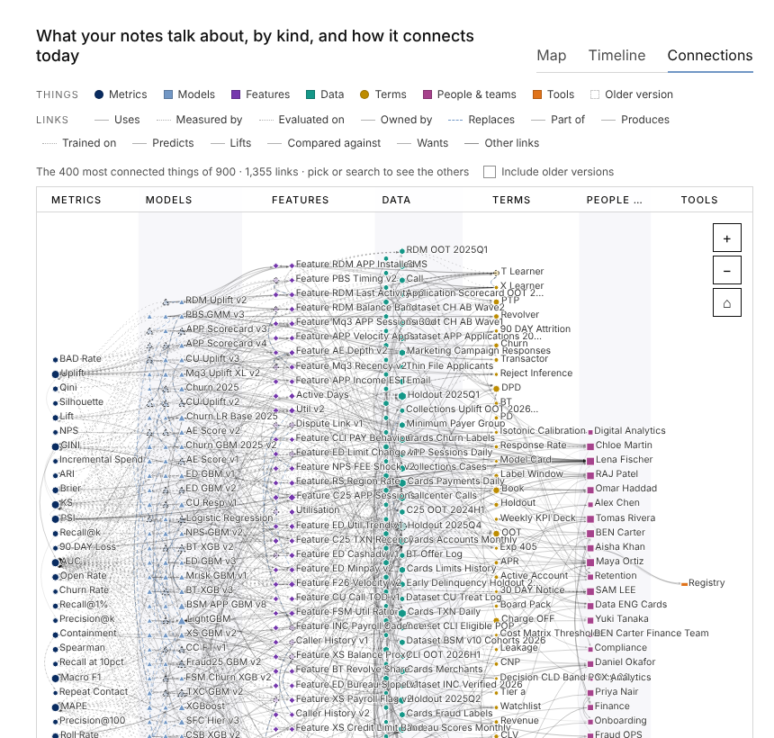

# memory-dream

Project memory for agents that do data-science and coding work. The memory is a folder of short notes.
A person or the main agent writes them. A grep that knows how the notes link answers questions about them.
A cheap model, if you want one, reads each note once and writes down the things it names. A web page shows
the whole memory and what may be wrong in it.

One Python file (standard library only), one HTML file, markdown and JSON. No server, no database to run,
no embeddings. Works for any agent with a shell, Python 3.9 and grep.

---

## The idea, told simply

Imagine a shoebox of index cards.

- **Each card says one thing.** "The new model scores 0.81." It has a date, and it says which older cards it
  came from, and which old card it replaces. That is a note.
- **You never erase a card.** When you change your mind, you write a new card that says "this replaces card 7".
  Both stay in the box. The newest one counts.
- **To find things, you flip through the cards looking for words.** That is grep. The box also knows which
  card replaced which, so it shows you the newest card first and tells you which ones are old.
- **A helper may read each card once** and write a sticky note on it: "this card talks about the model
  `churn-xgb-v3` and the dataset `cards.txn_daily`; it says the model was *trained on* the dataset, and here are
  the exact words it used." The helper never changes a card and must copy the exact words, so you can check.
- **A counter looks for trouble**: cards that point at a card that is not in the box, two current cards that
  seem to say opposite things, cards that are too long. It writes a list, and it never fixes anything by itself.
- **A map** lays the cards out by topic and time, draws the things they talk about and how they connect, and
  says, for each kind of statement, how much to trust it.

That is the whole system. Everything below is the same story with the real names.

---

## What it is, and what it is not

**It is**

- A folder convention: `memory/<area>/<id>.md`, one note per thing, with three front-matter fields.
- A search command, `ask`, that is grep plus a thin layer of memory: it expands a question into the ids and
  aliases the memory knows, greps the notes once, and orders what it finds by lineage, newest first.
- An optional index built by a cheap model (the "dreamer"): the things each note names (entities), the typed
  links it states between them (relations), each with the quoted line that states it.
- A reviewer, the same cheap model, asked once per dream about vocabulary, look-alike names and notes that may
  disagree. Its verdicts are plain-text lines you can edit.
- A set of checks (C1 to C12) and a self-contained viewer page with a "Worth checking" list.
- A skill: `SKILL.md` tells an agent when to read, how to write, and when to dream.

**It is not**

- Not a vector database and not embeddings. Nothing is ranked by similarity; words either occur or they do not.
- Not a reasoner. No inference, no inferred transitive or inverse links. The only walks are explicit: `from` and
  `supersedes` links, at most two hops, exactly as the notes state them.
- Not an editor of your notes. Nothing in the system rewrites a note, ever. The dreamer writes only under
  `_dream/`; the review appends lines to three small root files you own; the digest is regenerated.
- Not Claude Code's own memory. When the agent is Claude Code, `ask` also reads its auto-memory topic files and
  never writes there; `dream`, `log` and `viz` refuse to run on such a folder.
- Not a judge of truth. It quotes the line a fact came from and flags pairs that may disagree. A person decides
  anything the reviewer marks unsure.
- Not a replacement for grep. Plain `grep -rn … memory/` stays first-class and is sometimes the right call.
- Not a sync service or a multi-user store. It is files in a repository; git carries them.

---

## Why it is effective, and why it is cheap

**The notes are the truth, and they are small.** One claim per note, at most 40 lines, with the numbers, the
evaluation set, the count and the date in the first paragraph. A whole small project is a few thousand tokens.

**Answering is one grep, not many round trips.** The expensive thing for an agent is not reading; it is the
number of times it goes back and forth. `ask` takes every question and task of a session in one call, greps once,
and prints the answering lines under a one-line header per note that already says the kind, the date, what the
note was built on and what replaced it. Measured against a grep-only agent on the same questions:

| 10 questions, 3 runs each, judged against reference answers | correct / partial / wrong | tool calls | tokens | cost | time |
|---|---|---|---|---|---|
| 30 notes, with the memory | 26 / 3 / 1 | 1.3 | 104k | 0.93× | 40 s |
| 30 notes, grep only | 25 / 5 / 0 | 2.7 | 129k | 1× | 53 s |
| 1,677 notes, with the memory | 27 / 3 / 0 | 4.7 | 311k | 0.47× | 61 s |
| 1,677 notes, grep only | 26 / 4 / 0 | 25.3 | 1,465k | 1× | 172 s |

On 326 questions over the 1,677-note test bank, `ask` heads 93.8% of the gold notes and 97.6% of the numbers
asked for, in about 2,500 characters per question; it finds 89% of questions asked with an alias the notes use
rather than the id; and on 70 questions about things the memory does not hold, it says so every time instead of
guessing. Details and every run: `.specs/memory-dream/RESULTS.md`.

**The model is optional and reads each note once.** Without it, nothing is missing for answering: lineage, kinds,
dates, conflicts, the digest and the viewer all come from the notes themselves. With it, each note costs about
$0.0013 to $0.0022 once (a note is re-read only when its content changes), and you get entity names, aliases and
typed relations: about one point more gold recall, six more on alias questions, and the Connections and Map views.

**Everything derived is disposable.** Delete `_dream/` and the next dream rebuilds it. The only state that
matters is the notes and three small text files at the memory root.

---

## The note: what a person or the main agent writes

This is the one contract everybody has to keep. A note is a markdown file at `memory/<area>/<id>.md`.

```markdown
---
from: [exp-011-baseline, feat-velocity-v2]
updated: 2026-09-25
---
# XGBoost with 30-day velocity: AUC 0.81, recall@10 0.52 on holdout-2025q4
Adding the velocity features to the baseline set lifts AUC 0.71→0.81 and recall@10 0.29→0.52.
holdout-2025q4, n=1.2M, 2026-09-25. Model: XGBoost, 400 trees, depth 6. Notebook: `nb/exp014_xgb.ipynb`.
The lift is mostly from `vel_ratio_30_90`.
```

- **The filename is the id.** `exp-014`. A model's note is named after the model (`churn-xgb-v3`). Prefixes say
  what a note is: `exp-` experiment, `feat-` feature, `ds-` dataset, `dec-` decision, `fnd-` finding, `q-` question,
  `metric-`, `pref-`, `rule-`, `term-`; `…-vN` is a model.
- **The area is the folder.** A project (`churn-2026/`), or one of the areas that span projects: `prefs/`,
  `reporting/`, `glossary/`, `corrections/`, `howto/`, `qa/`, `people/`, `log/`.
- **Three front-matter fields.** `from:` the notes this one was built on. `supersedes:` the notes it overturns.
  `updated:` the date (`YYYY-MM-DD`). Optional `type:` names the kind when the prefix or folder does not.
- **The `# ` line is the claim.** The first paragraph is what is true now. Numbers carry the metric, the evaluation
  set, n and the date. Sources (tables, notebooks, queries) go in backticks.
- **At most 40 lines, plain markdown, nothing about the memory system itself.**
- **Never rewrite an old conclusion.** Write a new note with `supersedes:`. Here the model's third version
  replaces the second, and both notes stay:

```markdown
---
from: [feat-velocity-v3, feat-utilization-check]
supersedes: [churn-xgb-v2]
updated: 2026-10-30
---
# churn-xgb-v3: AUC 0.76, recall@10 0.43 on holdout-2025q4, no leakage
churn-xgb-v3 uses feat-velocity-v3 and feat-utilization-v1, same XGBoost settings as churn-xgb-v2.
…
```

- **Taste and house rules are notes too.** When someone says "no pie charts" or "round to one decimal for the
  board", that goes into `prefs/<first>-<last>-<topic>.md` (your own: `prefs/me-<topic>.md`): the rule, where it
  applies, why. When it changes, a new note with `supersedes:`.

*Simply:* one card, one thing, with a date; say which cards it came from; never erase, replace.

---

## The sticky note: what the dreamer writes

The dreamer is a cheap model (the skill uses Claude Haiku) called once per note with a fixed prompt. It is asked
for JSON only, and for nothing it cannot quote:

- the note's **kind** (`question | experiment | finding | decision | dataset | feature | model | metric | term |
  preference | rule | log | note`);
- the **entities** the note names, things someone would look up across notes: tables, features, models, metrics,
  segments, people, teams, defined terms. Each with an id, a type (`dataset | feature | model | metric | segment |
  person | team | term | tool`) and the surface forms copied verbatim from the note. Not columns, files, notebooks,
  numbers or note ids;
- the **relations** the note states, read "s *type* o", using one of the vocabulary types or saying `other` with the
  note's own verb as a label, each with a short quote copied verbatim from the note;
- the **refs**: ids or paths of other notes the text points to.

For the dataset note `churn-2026/ds-txn-2025q4.md` the answer is:

```json
{"path": "churn-2026/ds-txn-2025q4.md", "kind": "dataset",
 "entities": [{"id": "cards.txn_daily", "type": "dataset", "as": ["cards.txn_daily"], "lines": [4]},
              {"id": "data-eng-cards", "type": "team", "as": ["data-eng-cards"], "lines": [5]}],
 "relations": [{"s": "cards.txn_daily", "type": "owned-by", "label": "owned-by", "o": "data-eng-cards",
                "quote": "Owned by data-eng-cards", "line": 5}],
 "refs": []}
```

What happens to it:

- The script keeps a surface form only if it really occurs in the note, and a relation only if its quote is found.
  Anything ungrounded is dropped and counted (warning C4). This is the whole trust model: the dreamer may name
  things, but every fact it adds points at a line you can read.
- The answer is stored under `_dream/notes/<hash>.json`, keyed by the note's content, so a note is read again only
  when its text changes. Edits that revert reuse the old answer for 30 days.
- The eight relation types live in `memory/EDGES.md`: `uses`, `produces`, `part-of`, `trained-on`, `evaluated-on`,
  `measured-by`, `replaces`, `owned-by`, each with aliases (`~` means read in reverse). A link outside them keeps
  its label and is shown as `other/<label>`. A label becomes a type only after it is common enough (the `promote:`
  bar), through the review, within a `budget:` of types, and a proposed type goes back to a label after a
  `probation:` if it stays rare. Packs (`software`, `research`, `ops`) add a domain's types in one line.

**The reviewer** is the same cheap model, asked once per dream (at most 20 conflict pairs a time) about three
things: labels over the bar (alias onto a type, a new type with a definition, keep as a label, or drop), entity
pairs that may be the same thing (same or different; versions are never merged), and pairs of current notes of one
kind in one area that may disagree (one supersedes the other, compatible, or unsure). Its verdicts are appended as
plain lines to `EDGES.md`, `ALIASES.md` and `CONFLICTS.md`. Nothing is asked twice; an unsure pair waits for a
person; and you can write any of those lines yourself, at no model cost.

*Simply:* the helper may write names on a sticky note, but only words it can point to on the card. The sticky
note can be thrown away; the card cannot.

---

## Who decides what

| A person, or the main agent writing notes | The dreamer (cheap model) | The script, with no model at all |
|---|---|---|
| What is worth a note, and what it claims | Entity ids, types and surface forms | Lineage: `from`, `supersedes`, and note ids written in a body, resolved to files (C1, C2 when they do not resolve) |
| Which notes it was built on; which it replaces | Typed relations with their quoted line | Kinds: `type:` wins, then the dreamer's kind, then the prefix, then the folder; dates |
| Numbers, dates, sources | The note's kind when nothing else says | Which note is current: the chain of `supersedes` to its live end |
| Preferences and house rules | Refs to other notes | Which entities are kept: a home note, two or more mentioning notes, or an `ALIASES.md` line; folding of `.`, `_`, `-`, case; versions never merged |
| Hand lines in `EDGES.md`, `ALIASES.md`, `CONFLICTS.md` | Review verdicts: alias or new type, same or different, supersedes, compatible or unsure | Vocabulary gating: the bar, the budget, the probation |
| Whether an unsure conflict is a supersession | | Conflict candidates: two current notes of one kind in one area, not linked, sharing a rare title word, an id, a version pattern or a title |
| What to ask, and what to do with the answer | | Search: pattern expansion, one grep, scoring, lineage ordering, the weak-match marker |
| | | The checks C1 to C12, the digest, the index, the viewer and its "Worth checking" list |

Every decision in the right column is a rule you can read in `memory.py`, and every one in the middle column
leaves a quote behind. Only the left column is judgement.

---

## How an agent works with it

`memory.py` means `python3 <skill>/scripts/memory.py`. It finds the memory by `--root`, `$MEMORY_DIR`, or the
nearest `memory/` folder upward.

### Search: read first, once

```bash
memory.py ask "what came of exp-014?" "who owns cards.txn_daily?" "Make the Q4 chart for Chloe Martin's readout"
```

Every question and task of a session goes into one call. Per question it prints the answering lines under one
header per note:

```
## what came of exp-014?
▸ churn-2026/exp-014.md · experiment · 2026-09-25 · from exp-011-baseline, feat-velocity-v2
  5: # XGBoost with 30-day velocity: AUC 0.81, recall@10 0.52 on holdout-2025q4
▸ churn-2026/churn-xgb-v3.md · model · 2026-10-30 · from feat-velocity-v3, feat-utilization-check · supersedes churn-xgb-v2
  6: # churn-xgb-v3: AUC 0.76, recall@10 0.43 on holdout-2025q4, no leakage
▸ churn-2026/churn-xgb-v2.md · model · 2026-10-02 · from exp-014 · SUPERSEDED → churn-xgb-v3
  5: # churn-xgb-v2: XGBoost on velocity v2 + utilization, AUC 0.81 on holdout-2025q4
▸ churn-2026/post-period-leak.md · finding · 2026-10-29 · from exp-014, exp-017-leak-check
  5: # Post-period aggregation leaks target: AUC 0.81→0.74 without it
```

`SUPERSEDED → a → b` is history: the last name is current. "What came of X" walks down the `from` links; "why"
and "what led to" walk two hops up. For a task, the preferences and house rules that apply are added. A small
memory is printed whole when that costs about the same as the pointers. `(weak match: 'x' found nowhere in
memory)` means a word of the question occurs in no note: rephrase, or grep. Naming the project or an id scopes
the search. Then at most one batched follow-up.

### Add: write as you go

Write the file. That is the whole act.

```bash
cat > memory/churn-2026/exp-020-tenure-bins.md <<'NOTE'
---
from: [churn-xgb-v3]
updated: 2026-11-01
---
# Tenure bins add nothing: AUC 0.76 → 0.76 on holdout-2025q4
Five tenure bins on top of churn-xgb-v3's features; AUC unchanged, recall@10 0.43 → 0.44. n=1.2M, 2026-11-01.
Notebook: `nb/exp020_tenure.ipynb`. Not worth a model version.
NOTE
```

A scratch line that is not yet a note: `memory.py log "backfill running" -p churn-2026` appends a timestamped line
to `memory/log/<today>.md`. Logs are searched like everything else and never count as current knowledge.

### Maintain: dream at the end

```bash
memory.py dream          # lineage, kinds, conflicts, digest, viewer, index; with $MEMORY_LLM set, entities and relations too
memory.py check          # every warning C1–C12 in full, and whether the graph conforms to the contract
memory.py viz            # rewrite the viewer page, memory/_dream/graph.html
```

`dream` is safe to run in the background and stops after a scan when nothing changed. With a model command in
`$MEMORY_LLM` (for example `claude -p --model haiku --tools ""`), it reads new or changed notes, then asks the
review. Without one, it does everything that needs no model and says how many notes have no entities yet; an
agent that wants entities without a command runs `dream --prompts`, lets the `memory-dreamer` subagent answer the
prompt files under `_dream/pending/`, and runs `dream --prompts` again.

Every dream writes `memory/DIGEST.md`: how to ask, your own preferences, the newest current decisions and
models, the open questions, in at most 40 lines. One line in `CLAUDE.md`, `@memory/DIGEST.md`, keeps it in
context every session.

Three files at the memory root are yours: `EDGES.md` (the relation types), `ALIASES.md` (`- canonical = other`
merges two ids; `not: a / b` keeps them apart), `CONFLICTS.md` (`- a > b` makes a supersede b without touching
either note; `compatible: a / b`; `- a ? b` waits for a person). A hand edit costs no model calls and relabels
everything at the next dream.

### Delete, retire, move

- **To retire a conclusion, supersede it.** Write the new note with `supersedes:`. Both stay; `ask` lifts the
  newer one and marks the older `SUPERSEDED`; the viewer draws the older one hollow.
- **To remove a note, delete the file.** The next dream drops it from the graph. Notes that pointed at it get a
  C2 warning (a link to nothing), the things it named lose those mentions, and its cached reading is kept 30 days
  in case the file comes back. Nothing else needs doing.
- **To move or rename a note, move the file.** A dream recognises the same content at one new path, keeps the old
  path resolving, and relabels links. Renaming and editing in one step counts as a delete and a new note.
- **To start over, delete `_dream/`.** Everything in it is derived; the next dream rebuilds it. Notes whose
  readings are gone are read again, which is where the model cost returns.

### Look: the viewer

`memory/_dream/graph.html` is one file with no network requests, written for someone who knows nothing about
the mechanics. It opens on the **Map**: what a person wrote, what it became, who checked it, each with a count
and a verdict badge; one graph of the things the notes talk about, the most linked ones named, things with a note
of their own in their kind's colour; and two tables, what the memory holds and what each kind of statement is
worth. The pictures below are the 1,677-note test bank.


**Timeline** places every note by topic and date, with the lines between them. Picking a note shows it rendered
on the right, with every thing it mentions marked in the text, how it connects, what the assistant took from it
(each fact with a "Wrong?" button), and its family tree under the chart.


**Connections** shows the same things in one column per kind, the most connected named, with the current links as
curves between the columns.



**Worth checking** lists what may be wrong: notes that may disagree, names that may be the same thing, links that
look odd or lead nowhere, notes on their own. Each item has a "Copy question" button whose text you paste to the
assistant; the assistant then fixes the link, writes the superseding note, or tells you the two notes are
compatible.

---

## Install

```bash
cp -R skills/memory-dream <project>/.claude/skills/memory-dream          # or ~/.claude/skills/
cp skills/memory-dream/agents/memory-dreamer.md <project>/.claude/agents/   # only for the no-command dreamer
mkdir -p <project>/memory
python3 tests/acceptance.py                                               # 37 checks on the fixture, about a minute
```

## Where to read more

- `skills/memory-dream/SKILL.md`: the three habits an agent follows (read first, write as you go, dream at the end).
- `.specs/memory-dream/CONTRACT.md`: every field the script writes and reads, and the twelve warnings.
- `.specs/memory-dream/RUNBOOK.md`: daily use, the dreamer in command and file mode, troubleshooting.
- `.specs/memory-dream/RESULTS.md`: every measured phase, with the runs behind each number.
- `BUILD-GUIDE.md` and `online-build-bundle.md`: how to build it again from scratch, phase by phase, with exit
  conditions; the bundle is one markdown that splits at `<--->` lines.
- `tests/`: the churn-2026 fixture, the deterministic fake dreamer, the acceptance suite and the headless viewer
  check. `eval/`: the 1,677-note test bank, its 366 questions, and the agent evaluations.
