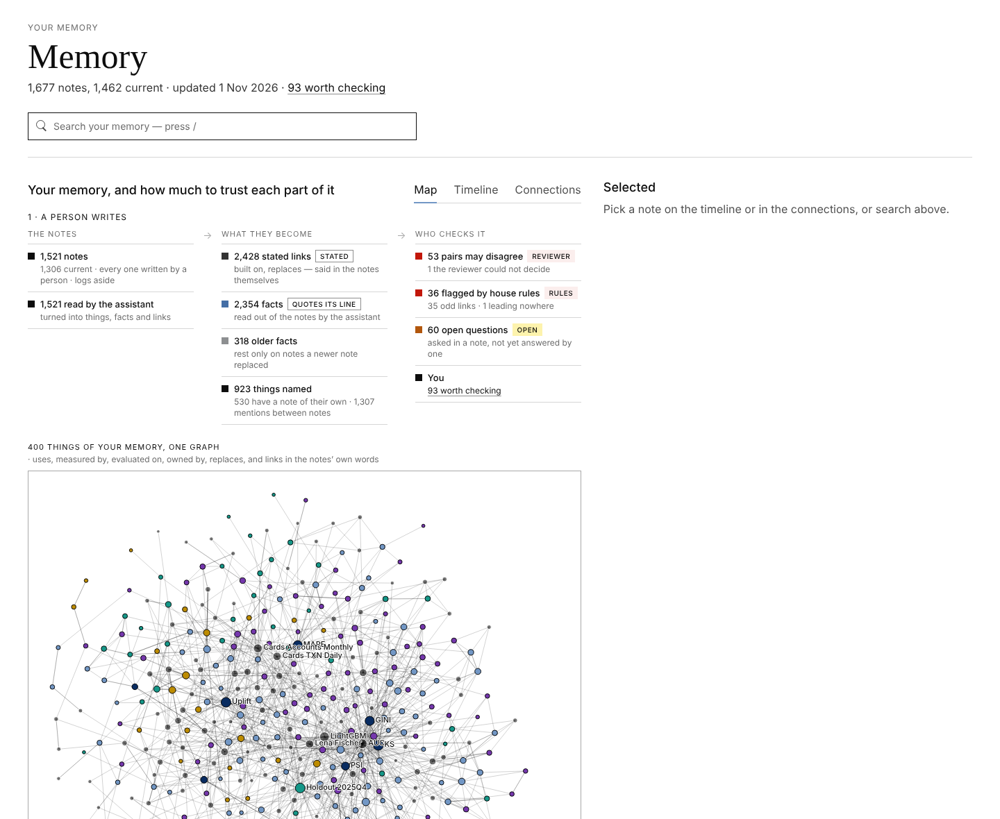
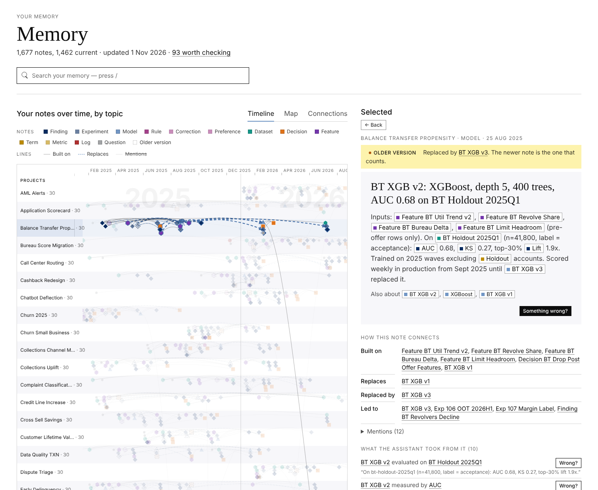

# memory-dream

Project memory for AI coding agents.

The agent writes short notes about its work into a folder in the repository. A command-line tool retrieves from
those notes, keeps them consistent, and renders a web page that shows the memory and what may be wrong in it.
An optional cheap model builds an index of the things the notes name.

Python standard library only. Markdown and JSON files. No server, no database service, no embeddings.

## What it buys

- **Same answers at half the cost.** Against an agent given the same notes and plain grep, an agent with the
  memory answers as accurately, at 0.47× the cost and 0.35× the time on 1,677 notes. The gap holds at 168,141
  notes (0.41× the cost).
- **Conclusions do not get lost or mixed up.** A change of mind is a new note that supersedes the old one.
  Retrieval lists the current note first and marks the old one as replaced. On 104 questions aimed at replaced
  conclusions, the successor is listed above the old note 95% of the time and the old note is marked 100%.
- **A memory that grows for months without a schema team or a vector store.** Identity is decided by rule, the
  relation vocabulary cannot grow past a budget, and the model reads each note once.
- **Everything can be checked.** Every indexed fact quotes the line it came from. A page a non-engineer can read
  lists what may be wrong and hands the question back to the agent in one click.
- **No infrastructure.** Python, grep, and files in the repository.

## The problem

An agent that works on a project for weeks produces results, decisions, data definitions and rules. Without
memory, every new session either starts blank or re-reads the whole project, which costs tokens and time. It also
cannot tell a current conclusion from one that was overturned last month.

## The approach

1. Everything worth remembering is written as a short note: one per result, decision, dataset, model, rule or
   question. Each note names the notes it was built on and the notes it replaces. Nothing is ever rewritten; a
   change of mind is a new note that supersedes the old one.
2. Retrieval is a text search over the notes, ordered by that lineage. The newest conclusion comes first and
   replaced ones are marked as replaced. One command answers every question of a session in one call.
3. A cheap model may read each note once and record which named things appear in it (datasets, models, metrics,
   people) and how they relate, with the sentence that says so as evidence. This adds synonyms and a map of the
   project. Answering works without it.
4. Checks flag anything inconsistent. A web page shows the memory and lists what may be wrong, for a person to
   review.

## Architecture

Four layers. Each is built only from the one below it.

| layer | what it is | produced by | cost |
|---|---|---|---|
| 1. Notes | `memory/<area>/<id>.md`, one file per thing, with three front-matter fields | the agent, or a person | writing a file |
| 2. Retrieval | `ask`: one grep pass over the notes, results ordered by lineage | the script | no model |
| 3. Index (optional) | the things each note names, typed links between them with quoted evidence, synonyms, conflict verdicts | a cheap model reads each note once; the script checks and stores the answer | about $0.002 per note, once |
| 4. Checks and viewer | twelve warnings, a digest, one self-contained HTML page | the script | no model |

Layer 1 is the only state that matters. Layers 2 to 4 live under `memory/_dream/` and can be deleted and rebuilt.

## Who decides what

| the agent or a person | the cheap model | the script (deterministic) |
|---|---|---|
| what is worth a note and what it claims | which named things a note mentions, and their types | lineage between notes, from the front matter |
| which notes it was built on, which it replaces | which links between things the note states, each with a quote | which note is current (following `supersedes` to the end) |
| numbers, dates, sources | synonyms: whether two names are the same thing | kinds, dates, which things are kept, the relation vocabulary's limits |
| preferences and house rules | conflicts: whether one of two notes supersedes the other | which pairs of notes to flag as possibly conflicting |
| the final word on anything the model marks unsure | | search, scoring, the twelve checks, the digest, the page |

The right column is rules anyone can read in `memory.py`. The middle column always leaves a quote behind. Only the
left column is judgement.

## Layer 1: the notes

A note is a markdown file at `memory/<area>/<id>.md`. The area is a project folder (`churn-2026/`) or a shared
folder (`prefs/`, `glossary/`, `howto/`, `people/`, and a few others). The filename is the id.

```markdown
---
from: [exp-011-baseline, feat-velocity-v2]
supersedes: []
updated: 2026-09-25
---
# XGBoost with 30-day velocity: AUC 0.81, recall@10 0.52 on holdout-2025q4
Adding the velocity features to the baseline lifts AUC 0.71 to 0.81 and recall@10 0.29 to 0.52.
holdout-2025q4, n=1.2M, 2026-09-25. XGBoost, 400 trees, depth 6. Notebook: `nb/exp014_xgb.ipynb`.
```

Rules:

- `from` lists the notes this one was built on. `supersedes` lists the notes it overturns. `updated` is the date.
- The first heading is the claim. The first paragraph is what is true now, with the metric, the evaluation set,
  the sample size and the date. Sources go in backticks.
- At most 40 lines. Plain markdown. Nothing about the memory system itself.
- Never edit an old conclusion. Write a new note with `supersedes`. Both notes stay; the newer one counts.
- Filename prefixes say what a note is: `exp-` experiment, `feat-` feature, `ds-` dataset, `dec-` decision,
  `fnd-` finding, `q-` question. A model's note is named after the model (`churn-xgb-v3`).
- Preferences and house rules are notes too, in `prefs/`: the rule, where it applies, why.

## Layer 2: retrieval

```bash
memory.py ask "what came of exp-014?" "who owns cards.txn_daily?"
```

The command expands each question with the ids and synonyms the memory knows, greps the notes once, and prints
the matching lines under one header per note. The header carries the kind, the date, what the note was built on
and what replaced it:

```
▸ churn-2026/churn-xgb-v3.md · model · 2026-10-30 · from feat-velocity-v3 · supersedes churn-xgb-v2
  6: # churn-xgb-v3: AUC 0.76, recall@10 0.43 on holdout-2025q4, no leakage
▸ churn-2026/churn-xgb-v2.md · model · 2026-10-02 · from exp-014 · SUPERSEDED → churn-xgb-v3
  5: # churn-xgb-v2: XGBoost on velocity v2 + utilization, AUC 0.81 on holdout-2025q4
```

The agent reads the current note first and knows the older one is history without opening either file. If a word
in the question occurs nowhere in the memory, the output says so instead of guessing. Plain grep remains available
and is sometimes the right tool.

## Layer 3: the index

A cheap model (Claude Haiku in our runs) is called once per note with a fixed prompt and must answer in JSON:

- the note's kind;
- the entities it names: tables, features, models, metrics, segments, people, teams, defined terms; each with a
  type and the exact spelling used in the note;
- the relations it states between those entities, each typed and each with a short quote from the note;
- references to other notes.

For a dataset note that says "Owned by data-eng-cards", the answer is:

```json
{"kind": "dataset",
 "entities": [{"id": "cards.txn_daily", "type": "dataset"}, {"id": "data-eng-cards", "type": "team"}],
 "relations": [{"s": "cards.txn_daily", "type": "owned-by", "o": "data-eng-cards", "quote": "Owned by data-eng-cards"}]}
```

The script keeps an entity only if its spelling occurs in the note and a relation only if its quote is found.
Everything else is dropped and counted. Every fact in the index therefore points at a line a person can read.

Relation types are a fixed list of eight (`uses`, `produces`, `part-of`, `trained-on`, `evaluated-on`,
`measured-by`, `replaces`, `owned-by`) with synonyms, kept in `memory/EDGES.md`. A link that fits none keeps its
own label and is shown as `other/<label>`. A label can become a type only after it is common, through the review,
within a budget.

The review is one more call to the same model per indexing run. It answers three kinds of question: whether a
common label is a synonym of an existing type or a new one; whether two names are the same thing; and whether one
of two notes that appear to disagree supersedes the other, or both stand, or it cannot tell. The verdicts are
appended as plain lines to `EDGES.md`, `ALIASES.md` and `CONFLICTS.md`. Nothing is asked twice. A person can write
or overrule any of these lines by hand.

The model reads a note again only when the note's content changes. Indexing the 1,677-note test bank cost under
$4 in total.

### What the index buys

For answering, little, and this is measured. With the index on, `ask` returns the gold note for 94.6% of 326
questions against 93.8% without it, four more complete answers, and 89% against 83% on questions that use a
synonym instead of the id, for 5% more characters. At the agent level the two are within noise (27 against 26
correct out of 30). Answering never depends on the index.

The index is a map and a reviewer, not a search engine. It pays in four places:

- cross-project questions by thing: "what uses `cards.txn_daily`" across 27 projects, through aliases and typed
  relations;
- the Connections and Map views, which show the project's things and their links;
- the review: pairs of notes that may disagree, decided for about $0.005 per 20 pairs and recorded as plain lines;
- facts with evidence: each extracted fact quotes its line and carries a button that sends a correction request.

Its cost is about $0.0015 per note, once.

## Layer 4: checks and the viewer

Twelve checks run on every indexing pass: links to notes that do not exist or are ambiguous, notes over 40 lines,
notes without a heading, facts the model could not ground, pairs of current notes that may disagree, relations
whose endpoints have unusual types, and a few more. `memory.py check` prints them all.

The viewer is `memory/_dream/graph.html`, one file with no network requests. It opens on the Map.



The Map shows, with counts, what the notes state themselves, what the model extracted, what rests only on replaced
notes, which pairs may disagree and which questions are open; one graph of the things the notes talk about; and a
table that says what each kind of statement is worth. The Timeline places every note by topic and date, and a
picked note is shown rendered, with the things it mentions marked, its links, and the facts the model read from it,
each with a button that copies a correction request for the agent.



"Worth checking" lists what may be wrong: notes that may disagree, names that may be the same thing, links that
look odd or lead nowhere, notes connected to nothing. Each item has a button that copies a ready question for the
agent, which then fixes the link, writes the superseding note, or records that the two notes are compatible.

## Operations

| task | what to do |
|---|---|
| search | `memory.py ask "q1" "q2" …` with every question and task of the session in one call |
| add | write the note file; `memory.py log "…" -p <project>` for a scratch line that is not yet a note |
| maintain | `memory.py dream` at the end of a session (safe in the background; stops early when nothing changed); `memory.py check`; `memory.py viz` |
| retire a conclusion | write the new note with `supersedes`; both stay, the new one counts |
| delete a note | delete the file; the next `dream` drops it and warns about notes that still link to it |
| move or rename a note | move the file; the next `dream` recognises the same content at the new path |
| start over | delete `memory/_dream/`; the next `dream` rebuilds it (the model re-reads notes whose results were deleted) |

`dream` needs a model command in `$MEMORY_LLM` to build the index (for example `claude -p --model haiku --tools ""`).
Without one it still builds lineage, kinds, conflicts, the digest and the page. Every `dream` writes
`memory/DIGEST.md`, at most 40 lines: current decisions and models, open questions, the user's own preferences.
One line in `CLAUDE.md`, `@memory/DIGEST.md`, keeps it in the agent's context.

## Results

Fresh agents answering ten questions each, three runs per cell, graded against reference answers. The memory arm
had the skill and the notes; the grep arm had the notes only.

| | correct / partial / wrong | tool calls | tokens | cost | time |
|---|---|---|---|---|---|
| 30 notes, memory | 26 / 3 / 1 | 1.3 | 104k | 0.93× | 40 s |
| 30 notes, grep | 25 / 5 / 0 | 2.7 | 129k | 1× | 53 s |
| 1,677 notes, memory | 27 / 3 / 0 | 4.7 | 311k | 0.47× | 61 s |
| 1,677 notes, grep | 26 / 4 / 0 | 25.3 | 1,465k | 1× | 172 s |

Offline, on 326 questions over the 1,677-note bank, `ask` returns the gold note for 93.8% of questions and the
number asked for in 97.6%, in about 2,500 characters per question. On 70 questions about things the memory does
not contain, it reports no match every time. Full record: `.specs/memory-dream/RESULTS.md`.

## Design decisions

### Problems avoided rather than solved

- No embedding model and no vector index. Notes written under the contract are short, carry their ids and numbers
  in the text, and are found by exact text match plus lineage. Nothing drifts, nothing has to be re-embedded.
- No ontology designed up front. The relation vocabulary starts at eight types and grows only from usage, under a
  budget.
- No entity-resolution model. Identity is a folding rule, one merge rule, a short list of hand aliases, and a
  yes-or-no question to the cheap model for the remaining look-alikes.
- No update problem. Notes are append-only. "Current" is derived by following `supersedes` links, so there is no
  state to keep consistent and no truth-maintenance logic.
- No model call per question. Retrieval is a grep. The model is paid once per note, at indexing time.
- No context pressure. The agent receives matching lines, not files, and a 40-line digest, not the memory.

### Identity and de-duplication

- Ids are folded before comparison: case, spaces, `.`, `_` and `-` do not distinguish, so `cards.txn_daily` and
  `cards-txn-daily` are one thing.
- `ALIASES.md` merges ids by hand (`- canonical = other`) or keeps them apart (`not: a / b`).
- One rule merges automatically: an id that exactly one other entity writes as one of its spellings is that entity.
- Ids that differ only in digits (`v2`, `v3`) are versions and are never merged, by rule or by review.
- An entity is kept only if it has a note of its own, is mentioned in two or more notes, or is named in
  `ALIASES.md`. File names, notebooks and columns are dropped; grep finds those.
- Remaining look-alikes are asked once of the cheap model (same or different), never when the two have different
  notes of their own. The answer lands in `ALIASES.md`.

On the 1,677-note bank: 7,060 mentions, 1,871 ids as written, 1,867 after folding, 1,861 after the alias file,
1,734 after the merge rule; 923 kept (530 with a note of their own, 393 named in two or more notes); 810 dropped as
named in one note only.

### What the model is told about the existing memory

Each indexing call carries the instructions, the current relation vocabulary from `EDGES.md`, and a KNOWN list:
the project's existing entities, at most 80, plus the 20 most-mentioned entities shared across projects, each with
its id, type and known spellings. The model must reuse a KNOWN id when the thing is already known. Notes are indexed
project by project in waves, and the list is refreshed between waves, so a note indexed late in a session sees what
earlier notes in the same project introduced. The cap keeps the prompt flat as the memory grows: the KNOWN part is
about 1,450 tokens on 1,677 notes and about 1,600 on 168,141.

### Caching and incremental work

- Each note's reading is stored under its content hash. A note is read by the model again only when its text
  changes; an edit that is reverted within 30 days reuses the old reading.
- Within a project, the instructions, vocabulary and KNOWN list are byte-identical across calls. The script marks
  that prefix and the command wrapper passes it as the system prompt, which the provider caches. This took the cost
  per note from $0.0022 to $0.0015.
- A manifest of hash, size and time per file lets a `dream` with nothing new stop after the scan: 3 seconds on
  168,141 notes.
- A hand edit to `EDGES.md`, `ALIASES.md` or `CONFLICTS.md` relabels everything at the next pass with no model calls:
  the graph is rebuilt from cached readings under the new names.
- The script's own hash is recorded, so an upgraded `memory.py` rebuilds the graph once, with no model calls.
- Above 10,000 notes, changed notes are patched into the last graph instead of a rebuild, the index lives in
  SQLite, and `ask` greps only the areas a question points at. At 168,141 notes a call takes 5 to 8 seconds.

### Keeping the vocabulary from growing without bound

The first reviewer, asked about 178 common labels, answered "new type" to all of them, and the vocabulary grew from
7 types to 185. The present rules came from that:

- Entity types are a fixed list of nine and note kinds a fixed list of thirteen; the model cannot add to either.
- Relation types start at eight. A link that fits none keeps its own label and is shown as `other/<label>`; it is
  stored and searchable but it is not a type.
- A label is offered to the review only after 5 uses in 5 notes across 2 areas. The review may alias it onto an
  existing type, keep it as a label, drop it, or propose a new type with a one-line definition. A new type is
  admitted only while the budget of 24 types has room.
- A proposed type is on probation for 60 days and falls back to a label if it is still under the bar.
- Verbs that link notes rather than things (`answers`, `led-to`, `basis-for`) are on a drop list.
- The review is asked once per item and at most 20 conflict pairs per pass. Hand-written lines are permanent.

### Living with an unreliable model

- A spelling the model reports must occur in the note and a quote must be found in it, or the item is dropped and
  counted (C4). The model can name things; it cannot invent facts that survive.
- An answer that cannot be parsed is retried once; after that the note stays grep-searchable and is flagged (C3).
- The model never writes to a note. Its verdicts are plain lines in three files that a person can edit or delete.
- One indexing run at a time, guarded by a lock file.

## What it is not

- Not a vector database. Nothing is ranked by similarity.
- Not a reasoning engine. The only inference is following `from` and `supersedes` links, at most two steps.
- Not an editor of notes. No part of the system rewrites a note.
- Not Claude Code's own memory. When the agent is Claude Code, `ask` also reads that memory and never writes to it.
- Not a judge of truth. It quotes evidence and flags possible conflicts; a person decides the unsure ones.
- Not a service. It is files in a repository.

## Install

```bash
cp -R skills/memory-dream <project>/.claude/skills/memory-dream
mkdir -p <project>/memory
python3 tests/acceptance.py        # 37 checks on the fixture
```

## Further reading

- `skills/memory-dream/SKILL.md`: the instructions the agent follows.
- `.specs/memory-dream/CONTRACT.md`: every field the script writes and reads, and the twelve checks.
- `.specs/memory-dream/RUNBOOK.md`: daily use and troubleshooting.
- `.specs/memory-dream/RESULTS.md`: every measurement, with the runs behind it.
- `BUILD-GUIDE.md`, `online-build-bundle.md`: how to rebuild it from scratch, phase by phase.
